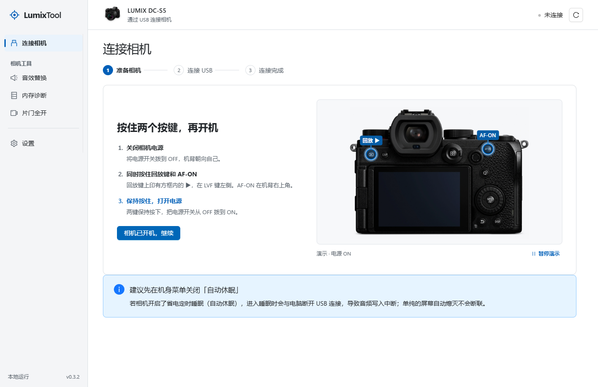
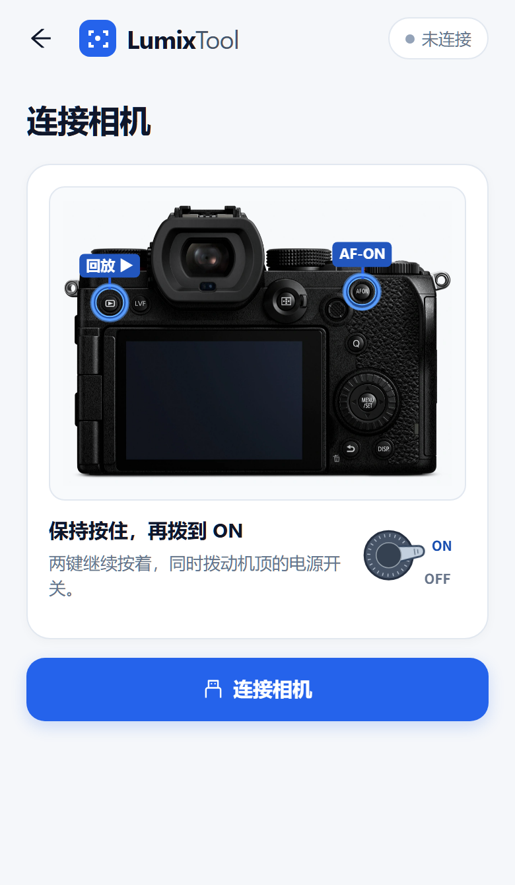

# LumixTool

[简体中文](README.md) | **English** | [日本語](README.ja.md)

A local, offline toolkit for Panasonic LUMIX cameras: unlock 6K Open Gate / unlimited recording and customize all 28 camera sounds (focus beep, electronic shutter, burst shutter, self-timer, etc.) over Service Mode USB — with **zero firmware flashing**.

> ⚠️ **Verified Scope**: Currently hardware-verified on **Panasonic DC-S5 (Mark I) with official firmware v2.9** only. Open Gate enforces firmware signature checks; sound writes only modify volatile RAM. Start with a short clip on a single slot.

- **RAM-only, no Flash writes**: Changes persist across power-switch off/on (warm reboot) and **reset completely on battery pull or factory reset**.
- Custom sounds are stored in camera scratch RAM (`0x8F000000+`) with free-region guards to avoid overwriting other custom slots.
- **Multi-language UI**: Supports **Chinese / English / Japanese** with a first-launch language picker and in-app Settings switcher.
- **100% local & offline**: No internet connection required.



## Features

| Tool | Description |
|---|---|
| **Sound Replacer** | Full catalog of all 28 camera sound slots (including AF beep `#1–3`, E-Shutter single `#20–22`, E-Shutter burst `#11–13`, Self-Timer `#0`, etc.) with one-click common presets, single/batch write, and stock restore. Accepts wav / mp3 / m4a / flac / ogg / opus and auto-converts to 44.1 kHz mono (up to 3 seconds). |
| **Open Gate Unlock** | One-click unlock for 6K 3:2 Open Gate (`5952×3968`), 5.9K 16:9 (`5888×3312`) 23.98p 10-bit HEVC, and unlimited recording in all time-limited modes — plus one-click restore. Verifies 13 firmware anchors before patching 19 volatile RAM halfwords. |
| **Memory Diagnostics** | Read-only scan of camera scratch RAM with a visual map of free/used regions and JSON export. |
| **Connect Camera** | One-click WinUSB driver installer, driver diagnostics, and animated Service Mode button guide. |
| **i18n & Settings** | Switch between Chinese, English, and Japanese anytime, view app version, and support the project on GitHub. |

## Android App (APK)

Connect your Android phone (Android 8.0+ with USB OTG) directly to a Panasonic LUMIX DC-S5 (v2.9) offline:

| Screen | What you can do |
|---|---|
| **Connect Camera** | Animated button guide showing Playback (▶) + AF-ON + Power ON timing, live firmware & unlock status. |
| **Open Gate Unlock** | Toggle 6K 3:2 / 5.9K 16:9 and unlimited recording, or restore stock defaults. |
| **Camera Sound Replacer** | Quick-pick **Common** tab (AF beep, E-Shutter single / all 3 tones, E-Shutter burst, Self-Timer) plus **All 28** slots with custom labels and restore. |
| **Settings** | Located to the right of the connection status pill in the top bar: language switcher (ZH / EN / JA), version info, GitHub Star, and OTA placeholder (coming soon). |

<p>
  
  
</p>

**Install**: Download the latest `LumixTool-*.apk` from [Releases](https://github.com/USER-HFC/Lumix_Tool/releases), allow installation from unknown sources, choose your language on first launch, and connect via USB OTG.

## Windows Quick Start

- **Requirements**: Windows 10 / 11 (64-bit), Panasonic DC-S5 (v2.9), data-capable USB cable. Python is bundled in the release zip.
1. Download `LumixTool-<version>-win-x64.zip` from [Releases](https://github.com/USER-HFC/Lumix_Tool/releases), **extract all files** to Desktop or Documents, and run `LumixTool.exe`.
2. **Enter Service Mode**: Power off the camera, hold **Playback (▶) + AF-ON** together, switch power **ON**, and connect USB (`04DA:2370`).
3. **Install WinUSB Driver** (once): Click "One-Click Install Driver" in Connect Camera (or use Zadig per [docs/DRIVER_SETUP.md](docs/DRIVER_SETUP.md)).
4. **Apply & Warm Reboot**: After writing sounds, toggle the **power switch OFF and ON** (do **not** remove the battery) for changes to take effect.

## Notes

- **Write speed**: ~2 ms per sample (~1.5 min for 1 second of audio). Disable camera Auto Power Off / Sleep or tap the touchscreen periodically during long writes.
- **Electronic shutter sounds**: `#20–22` (single) and `#11–13` (burst) only play when the camera is set to **Electronic Shutter** with shutter volume enabled.
- **Stock restore**: Original sound table entries are backed up locally per body version on first connect; pulling the battery always restores full stock state.

## Development

```sh
cd app
npm ci
npm start             # Build desktop UI and launch Electron
npm run dev           # Dev mode with HMR
npm test              # Run JS tests
npm run build:android # Build Android WebView bundle
npm run dist:win      # Package portable Windows zip
```

Mock mode (no camera required):

```sh
LUMIXTOOL_MOCK=1 npm start
```

## Acknowledgements

Special thanks to the open-source projects that contributed key research and references to LumixTool:

- **[rileydeacon/s5-unlocker](https://github.com/rileydeacon/s5-unlocker)** — 19-halfword volatile RAM patches and 13 firmware signature anchors for DC-S5 (MC801 v2.9) 6K Open Gate, 5.9K, and unlimited recording.
- **[yis2014/Lumix_S5](https://github.com/yis2014/Lumix_S5)** — DC-S5 v2.9 firmware reverse engineering, 5-round AES partition decryption research, memory address maps, and architecture references.

## Disclaimer

This project is not affiliated with Panasonic. Service Mode and direct RAM modification are unsupported by the manufacturer; use at your own risk.
