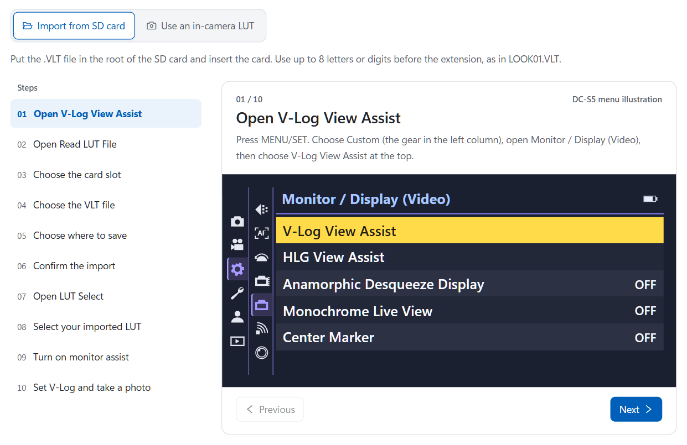
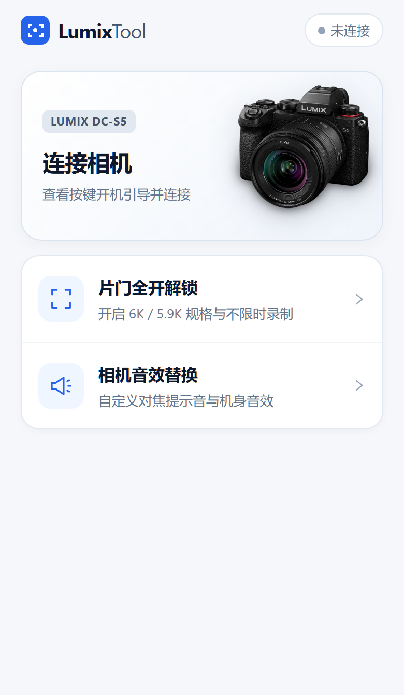

# LumixTool

[简体中文](README.md) | **English** | [日本語](README.ja.md)

A local, offline toolkit for Panasonic LUMIX cameras. Apply a LUT to JPEG photos as you shoot, unlock 6K Open Gate and unlimited recording, or customize all 28 camera sounds over Service Mode USB. No firmware flashing is required.

**Download v0.4.2**　[Windows x64 ZIP](https://github.com/USER-HFC/Lumix_Tool/releases/download/v0.4.2/LumixTool-0.4.2-win-x64.zip) · [Android APK](https://github.com/USER-HFC/Lumix_Tool/releases/download/v0.4.2/LumixTool-0.4.2.apk) · [Release notes and checksums](https://github.com/USER-HFC/Lumix_Tool/releases/tag/v0.4.2)

> **Supported camera**　Panasonic DC-S5 (Mark I) with official firmware 2.9. Writing a LUT directly to the camera is a beta feature awaiting hardware testing.

- Changes to the camera are held in RAM. They survive a power-switch restart and reset when you remove the battery or restore factory settings.
- Custom sounds are stored in camera scratch RAM (`0x8F000000+`) with free-region guards to avoid overwriting other custom slots. For your first sound replacement, try a short clip in one slot.
- **Multi-language UI**: Supports **Chinese / English / Japanese** with a first-launch language picker and in-app Settings switcher.
- **100% local & offline**: No internet connection required.

## Features

| Tool | Description |
|---|---|
| **Real-Time LUT** | Apply a LUT to JPEG photos on the DC-S5. Prepare a LUT offline for an SD card, or write it to a connected camera (Beta). |
| **Sound Replacer** | Full catalog of all 28 camera sound slots (including AF beep `#1–3`, E-Shutter single `#20–22`, E-Shutter burst `#11–13`, Self-Timer `#0`, etc.) with one-click common presets, single/batch write, and stock restore. Accepts wav / mp3 / m4a / flac / ogg / opus and auto-converts to 44.1 kHz mono (up to 3 seconds). |
| **Open Gate Unlock** | One-click unlock for 6K 3:2 Open Gate (`5952×3968`), 5.9K 16:9 (`5888×3312`) 23.98p 10-bit HEVC, and unlimited recording in all time-limited modes — plus one-click restore. Verifies 13 firmware anchors before patching 19 volatile RAM halfwords. |
| **Memory Diagnostics** | Read-only scan of camera scratch RAM with a visual map of free/used regions and JSON export. |
| **Connect Camera** | One-click WinUSB driver installer, driver diagnostics, and animated Service Mode button guide. |
| **i18n & Settings** | Switch between Chinese, English, and Japanese anytime, view app version, and support the project on GitHub. |

## Real-Time LUT for JPEG photos

Open **Real-Time LUT** on Windows or Android. The look applies to JPEG photos only. When shooting RAW+FINE, look for the graded image in the accompanying JPEG.

1. Under **Camera activation**, connect the DC-S5 over USB and select **Activate**. Keep the cable connected until **Activation complete** appears.
2. Under **LUT transfer**, use **Choose LUT file** for either `.cube` or `.vlt`. Choose **Export VLT for SD card** to save a copy offline, then put it in the root of the card. Use up to eight letters or digits before the extension, as in `LOOK01.VLT`. For a temporary copy, select **Write to camera** and choose a slot. Direct writing is **Beta and has not been tested on hardware**. The slot keeps its original menu name.
3. In **Camera guide**, follow **Import from SD card** or **Use an in-camera LUT**. When importing, choose the card, the file and one of the four registration slots. Confirming an occupied slot overwrites its LUT. Select your LUT in **LUT Select**, turn on **LUT View Assist (Monitor)**, and set **Photo Style** to **V-Log**. Use FINE or RAW+FINE to shoot the JPEG. The built-in `Vlog_709` needs no file import.

**After a battery change**, activate Real-Time LUT again. Removing the battery clears a directly written LUT. Keep the VLT in the SD card root so you can load it again.



*LumixTool v0.4.2 with a simulated camera connection. The yellow bar highlights the menu item to select.* [Panasonic DC-S5 Operating Instructions, pp. 278–279](https://eww.pavc.panasonic.co.jp/dscoi/DC-S5/P_PP/DC-S5_DVQP2197ZD_full_eng.pdf#page=278)

## Android App (APK)

Connect your Android phone (Android 8.0+ with USB OTG) directly to a Panasonic LUMIX DC-S5 (v2.9) offline:

| Screen | What you can do |
|---|---|
| **Connect Camera** | Animated button guide showing Playback (▶) + AF-ON + Power ON timing, live firmware & unlock status. |
| **Real-Time LUT** | Activate LUT output for JPEGs via USB OTG, prepare or transfer a LUT, and follow the illustrated camera guide. |
| **Open Gate Unlock** | Toggle 6K 3:2 / 5.9K 16:9 and unlimited recording, or restore stock defaults. |
| **Camera Sound Replacer** | Quick-pick **Common** tab (AF beep, E-Shutter single / all 3 tones, E-Shutter burst, Self-Timer) plus **All 28** slots with custom labels and restore. |
| **Settings** | Located to the right of the connection status pill in the top bar: language switcher (ZH / EN / JA), version info, GitHub Star, and OTA placeholder (coming soon). |

These screenshots show the home screen and USB connection guide from an earlier Android release.

<p>
  
  
</p>

**Install**: Download the latest `LumixTool-*.apk` from [Releases](https://github.com/USER-HFC/Lumix_Tool/releases), allow installation from unknown sources, choose your language on first launch, and connect via USB OTG.

## Windows Quick Start


- **Requirements**: Windows 10 / 11 (64-bit), Panasonic DC-S5 (v2.9), data-capable USB cable. Python is bundled in the release zip.
1. Download `LumixTool-<version>-win-x64.zip` from [Releases](https://github.com/USER-HFC/Lumix_Tool/releases), **extract all files** to Desktop or Documents, and run `LumixTool.exe`.
2. **Enter Service Mode**: Power off the camera, hold **Playback (▶) + AF-ON** together, switch power **ON**, and connect USB (`04DA:2370`).
3. **Install WinUSB Driver** (once): Click "One-Click Install Driver" in Connect Camera (or use Zadig per [docs/DRIVER_SETUP.md](docs/DRIVER_SETUP.md)).
4. **Apply & Warm Reboot**: After writing sounds, toggle the **power switch OFF and ON** (do **not** remove the battery) for changes to take effect.

## Notes

- **Write speed**: ~2 ms per sample (~1.5 min for 1 second of audio). Disable camera Auto Power Off / Sleep or tap the touchscreen periodically during long writes.
- **Electronic shutter sounds**: `#20–22` (single) and `#11–13` (burst) only play when the camera is set to **Electronic Shutter** with shutter volume enabled.
- **Stock restore**: Original sound table entries are backed up locally per body version on first connect; pulling the battery always restores full stock state.

## Development

```sh
cd app
npm ci
npm start             # Build desktop UI and launch Electron
npm run dev           # Dev mode with HMR
npm test              # Run JS tests
npm run build:android # Build Android WebView bundle
npm run dist:win      # Package portable Windows zip
```

Mock mode (no camera required):

```sh
LUMIXTOOL_MOCK=1 npm start
```

## Acknowledgements

Special thanks to the open-source projects that contributed key research and references to LumixTool:

- **[rileydeacon/s5-unlocker](https://github.com/rileydeacon/s5-unlocker)** — 19-halfword volatile RAM patches and 13 firmware signature anchors for DC-S5 (MC801 v2.9) 6K Open Gate, 5.9K, and unlimited recording.
- **[yis2014/Lumix_S5](https://github.com/yis2014/Lumix_S5)** — DC-S5 v2.9 firmware reverse engineering, 5-round AES partition decryption research, memory address maps, and architecture references.

## Disclaimer

This project is not affiliated with Panasonic. Service Mode and direct RAM modification are unsupported by the manufacturer; use at your own risk.
