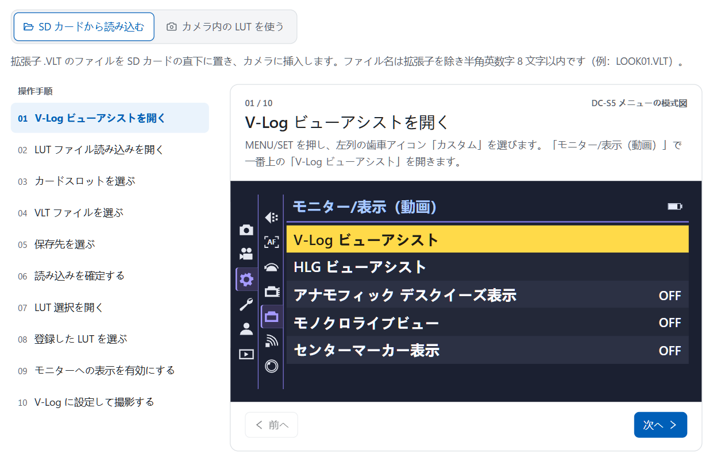
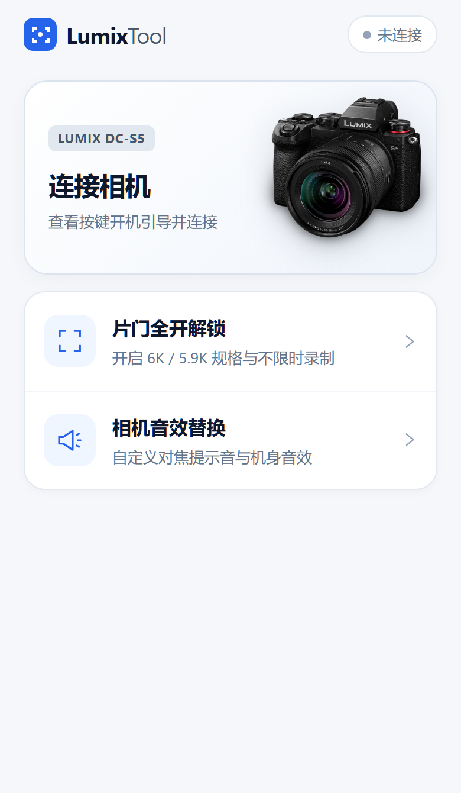
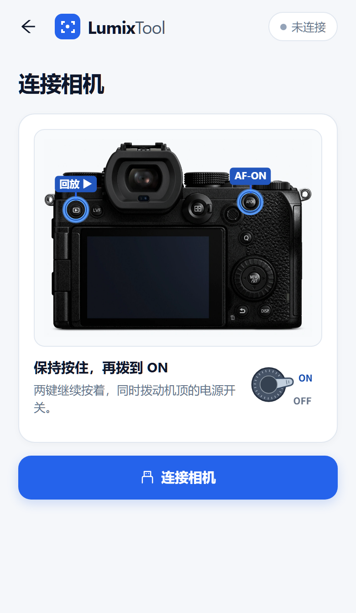
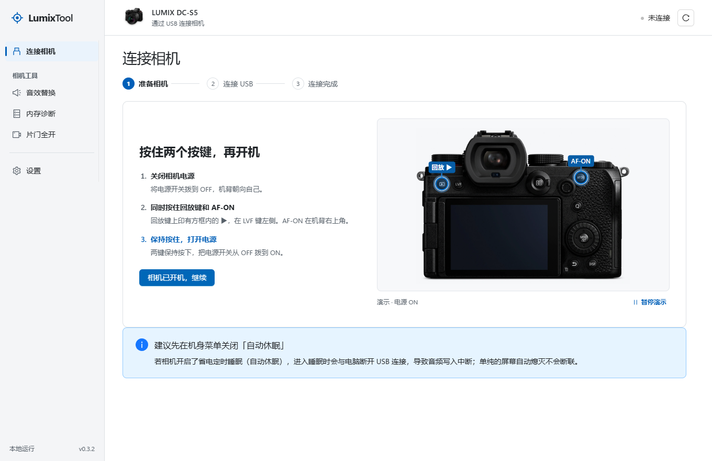

# LumixTool

[简体中文](README.md) | [English](README.en.md) | **日本語**

Panasonic LUMIX カメラ向けのローカル・オフラインツールボックスです。サービスモード USB 経由で、**ファームウェア書き換え（フラッシュ書込）なし**に 6K オープンゲート / 録画時間無制限を解除し、AF 合焦音・電子シャッター音・セルフタイマー音など全 28 種のカメラ効果音を自由にカスタマイズできます。

Windows 版と Android 版のどちらでも、初代 DC-S5 で LUT を適用した JPEG 写真を撮影できます。

**v0.4.2 ダウンロード**　[Windows x64 用 ZIP](https://github.com/USER-HFC/Lumix_Tool/releases/download/v0.4.2/LumixTool-0.4.2-win-x64.zip) · [Android 用 APK](https://github.com/USER-HFC/Lumix_Tool/releases/download/v0.4.2/LumixTool-0.4.2.apk) · [リリースノートとチェックサム](https://github.com/USER-HFC/Lumix_Tool/releases/tag/v0.4.2)

> **対応機種**　Panasonic DC-S5（初代）、公式ファームウェア 2.9。LUT をカメラに直接書き込む機能はベータ版で、実機では未検証です。

- カメラ本体の変更は RAM に保存されます。電源スイッチで再起動しても保持されますが、バッテリーを抜くか設定をリセットすると元に戻ります。
- カスタム効果音はカメラ RAM の空き領域（`0x8F000000`〜）に書き込み、既存スロットを上書きしないよう事前検証します。初回は短い音声で 1 項目だけ試してください。
- **多言語対応**：**中国語 / 英語 / 日本語**に対応。初回起動時に言語を選択でき、設定画面からいつでも変更可能です。
- **完全オフライン動作**：ネットワーク通信は行いません。

## 主な機能

| ツール | 内容 |
|---|---|
| **リアルタイム LUT** | JPEG 写真への LUT 適用を有効化。CUBE・VLT の読み込み、SD カード用 VLT の書き出し、カメラへの直接書き込み（ベータ・実機未検証）に対応。 |
| **効果音カスタム** | 全 28 種のカメラ効果音（AF 合焦音 `#1–3`、電子シャッター単写 `#20–22`、電子シャッター連写 `#11–13`、セルフタイマー `#0` など）を完全マッピング。よく使う項目のワンクリック選択、単一・一括書込、標準復元に対応。wav / mp3 / m4a / flac / ogg / opus を自動で 44.1 kHz モノラル（最大 3 秒）に変換します。 |
| **オープンゲート解除** | 6K 3:2 オープンゲート（`5952×3968`）、5.9K 16:9（`5888×3312`）23.98p 10-bit HEVC と全モードの録画時間制限解除をワンクリックで有効化・復元。13 箇所のファームウェア特徴を検証後、19 個の RAM ハーフワードのみ書き換えます。 |
| **メモリ診断** | カメラ RAM 空き領域を読み取り専用でスキャンし、使用状況を可視化・JSON エクスポート可能。 |
| **カメラ接続** | WinUSB ドライバのワンクリック導入、状態確認、サービスモード起動アニメーションガイド。 |
| **多言語・設定** | 中国語 / 英語 / 日本語の切替、バージョン表示、GitHub 応援リンク。 |

## リアルタイム LUT で JPEG 写真を撮る

対象は初代 DC-S5（ファームウェア 2.9）の **JPEG 静止画のみ**です。Windows または Android でカメラを接続し、「リアルタイム LUT」→「機能の有効化」→「有効にする」を選びます。「有効になりました」と表示されたらカメラを操作できます。内蔵の `Vlog_709` を使う場合は、ファイルの準備を省いて下の「カメラでの設定」に進んでください。



*v0.4.2 の模擬カメラ環境で表示した「使い方ガイド」です。黄色の行がカメラで選ぶ項目です。* [DC-S5 取扱説明書（英語版、278–279 ページ）](https://eww.pavc.panasonic.co.jp/dscoi/DC-S5/P_PP/DC-S5_DVQP2197ZD_full_eng.pdf#page=278)

### 自分の LUT を使う

「LUT 書き込み」→「LUT ファイルを選択」で、`.cube` と `.vlt` のどちらも読み込めます。必要な形式変換はアプリが行います。

| 使用方法 | 操作と保存先 |
|---|---|
| **SD カード用に VLT を保存** | カメラ未接続でも「VLT を書き出す」で保存できます。書き出したファイルを SD カードの直下に置きます。ファイル名は拡張子を除いて半角英数字 8 文字以内です（例：`LOOK01.VLT`）。バッテリー交換後も同じ LUT を使いたい場合は、カードにファイルを残してください。 |
| **カメラに書き込む**（ベータ・実機未検証） | 接続したカメラの「書き込み先スロット」を選んで書き込みます。カメラには元のスロット名が表示されます。バッテリーを抜くと、直接書き込んだ LUT は消去されます。 |

### カメラでの設定

1. MENU/SET を押し、「カスタム」（歯車）→「モニター/表示（動画）」→「V-Log ビューアシスト」を開きます。
2. **SD カードから読み込む場合**は「LUT ファイル読み込み」でカードを挿したスロットを選び、ファイルと登録先を指定して確定します。使用中の登録先を選ぶと、その LUT が上書きされます。
3. 「LUT 選択」で使いたい LUT を選び、「LUT ビューアシスト（モニター）」を ON にします。内蔵 LUT は `Vlog_709`、直接書き込んだ LUT は書き込み時に指定したスロットを選びます。
4. 写真撮影画面で Q を押し、「フォトスタイル」を V-Log に設定します。画質を FINE または RAW+FINE にして撮影し、JPEG の色を確認します。

**バッテリーを交換した後は、アプリで写真への LUT 適用を再度有効にしてください。** カードに保存した VLT は交換後も読み込めます。

## Android 版（APK）

Android 8.0 以上・USB OTG 対応スマートフォンから、PC なしで LUMIX DC-S5（v2.9）へ直接接続できます。

| 画面 | できること |
|---|---|
| **リアルタイム LUT** | JPEG 写真への LUT 適用、LUT の読み込みと書き出し。「使い方ガイド」でカメラの操作手順を確認できます。 |
| **カメラ接続** | 再生（▶）＋ AF-ON を押しながら電源 ON する手順をアニメーションで案内。接続後はファームウェアと解除状態を表示。 |
| **オープンゲート解除** | 6K 3:2 / 5.9K 16:9 と録画時間無制限の有効化・標準復元。 |
| **カメラ効果音カスタム** | 「よく使う音」タブ（AF 合焦音、電子シャッター単写 / 全 3 音色、連写音、セルフタイマー音）で素早く選択でき、「全 28 項目」で細かな置換・復元も可能。 |
| **設定** | 上部バーの接続ステータス右側に配置：言語切替（中 / 英 / 日）、バージョン表示、GitHub Star、OTA 更新（未開発）。 |

以下は Android 旧版のホーム画面と USB 接続ガイドです。

<p>
  
  
</p>

**インストール**：[Releases](https://github.com/USER-HFC/Lumix_Tool/releases) から最新の `LumixTool-*.apk` をダウンロードしてインストールしてください。初回起動時に言語を選び、USB OTG でカメラを接続します。

## Windows 版 クイックスタート

- **動作環境**：Windows 10 / 11（64-bit）、Panasonic DC-S5（v2.9）、データ転送対応 USB ケーブル（Python はパッケージに同梱済み）。
1. [Releases](https://github.com/USER-HFC/Lumix_Tool/releases) から `LumixTool-<version>-win-x64.zip` をダウンロードし、デスクトップやドキュメント等へ**すべて展開**して `LumixTool.exe` を起動します。
2. **サービスモードで起動**：カメラの電源を切り、背面の**再生ボタン（▶）と AF-ON** を同時に押したまま電源を ON にし、USB で PC と接続します（`04DA:2370`）。
3. **ドライバ導入（初回のみ）**：「カメラ接続」からワンクリック導入（失敗時は [docs/DRIVER_SETUP.md](docs/DRIVER_SETUP.md) を参照）。
4. **反映方法**：効果音の書込完了後、**バッテリーを入れたまま**電源スイッチを OFF → ON にしてお試しください。



## 注意事項

- **書込時間**：1 サンプル約 2 ms（1 秒の音声で約 1.5 分）。長めの音声を書き込む際はカメラの「自動パワーオフ（スリープ）」をオフにするか、画面を時々タップしてください。
- **電子シャッター音**：`#20–22`（単写）および `#11–13`（連写）は、カメラ側で**電子シャッター**を選び、シャッター音量をオンにしている場合に鳴ります。
- **標準への復元**：初回接続時に元の効果音テーブルを自動バックアップします。アプリから復元するか、バッテリーを抜き差しすれば完全に元へ戻ります。

## 開発コマンド

```sh
cd app
npm ci
npm start             # デスクトップ UI をビルドして起動
npm run dev           # 開発モード（HMR）
npm test              # JS テスト実行
npm run build:android # Android WebView 用バンドルをビルド
npm run dist:win      # Windows ポータブル zip を作成
```

モックモード（実機なしでの UI 確認）：

```sh
LUMIXTOOL_MOCK=1 npm start
```

## 謝辞（Acknowledgements）

本プロジェクトの開発・解析にあたり、以下の素晴らしいオープンソースプロジェクトを参考にさせていただきました。深く感謝申し上げます。

- **[rileydeacon/s5-unlocker](https://github.com/rileydeacon/s5-unlocker)** — DC-S5（MC801 v2.9）向け 6K オープンゲート / 5.9K / 録画時間無制限の 19 ハーフワード RAM パッチおよび 13 箇所のファームウェア検証アンカー。
- **[yis2014/Lumix_S5](https://github.com/yis2014/Lumix_S5)** — DC-S5 v2.9 ファームウェア解析、5 ラウンド AES 全パーティション復号研究、メモリアドレス表および拡張アーキテクチャの参考資料。

## 免責事項

本プロジェクトは Panasonic 株式会社とは一切関係ありません。サービスモードの利用およびカメラ RAM の直接書き換えはメーカー非公式の行為であり、すべて自己責任でご利用ください。
