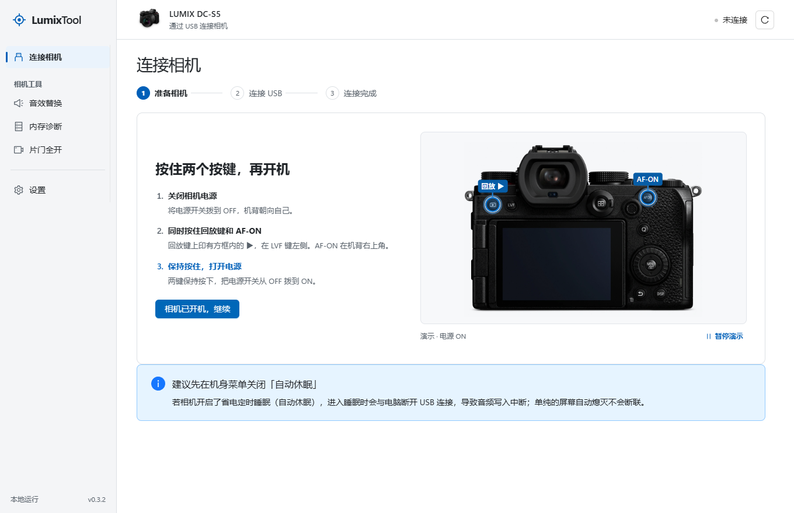
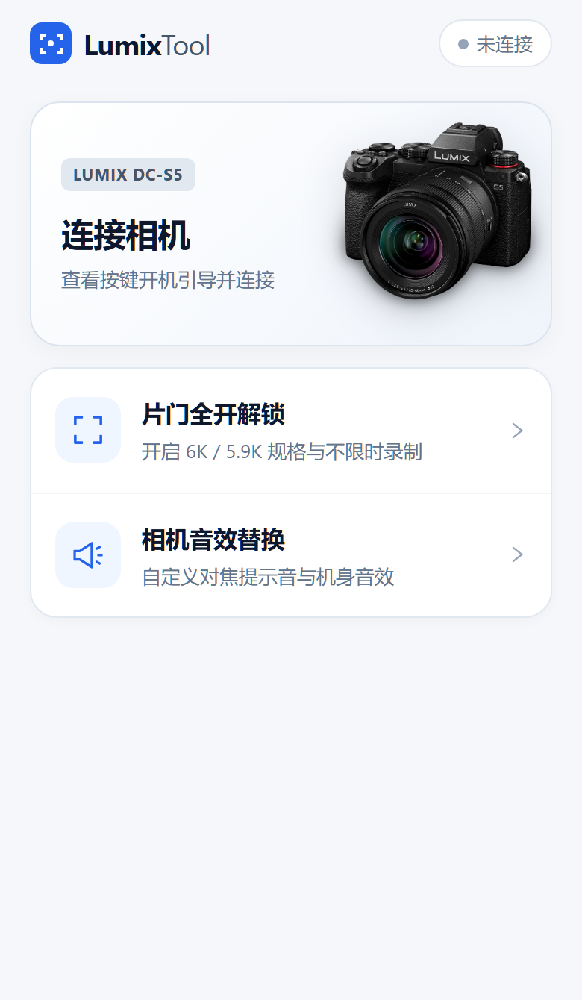
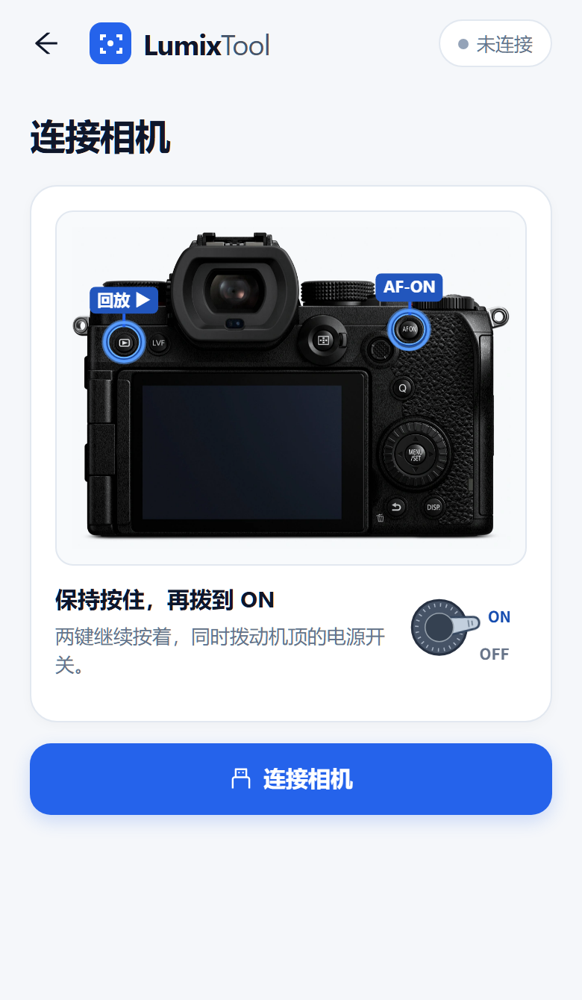
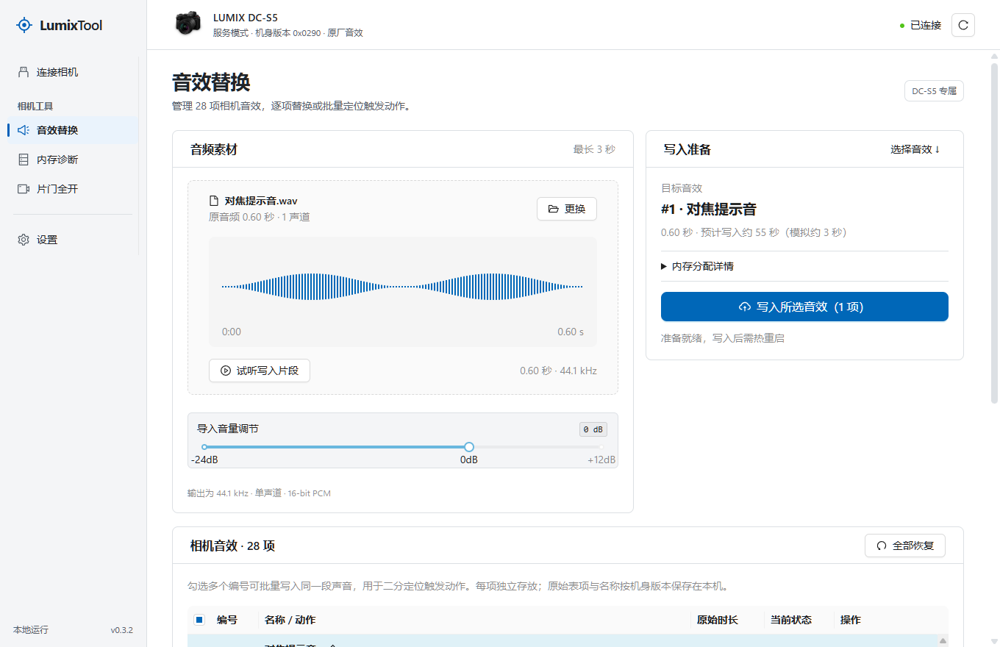
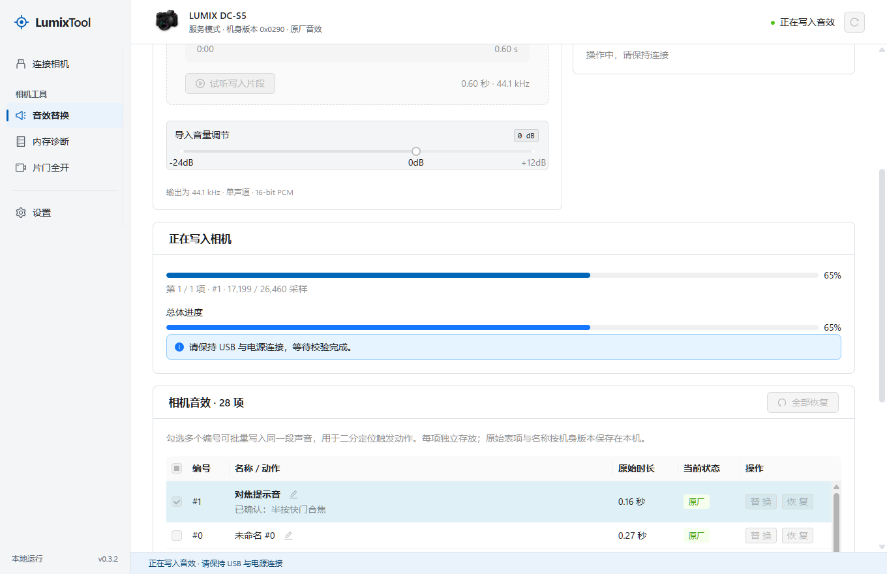
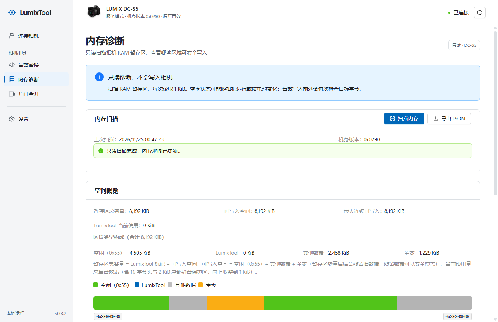
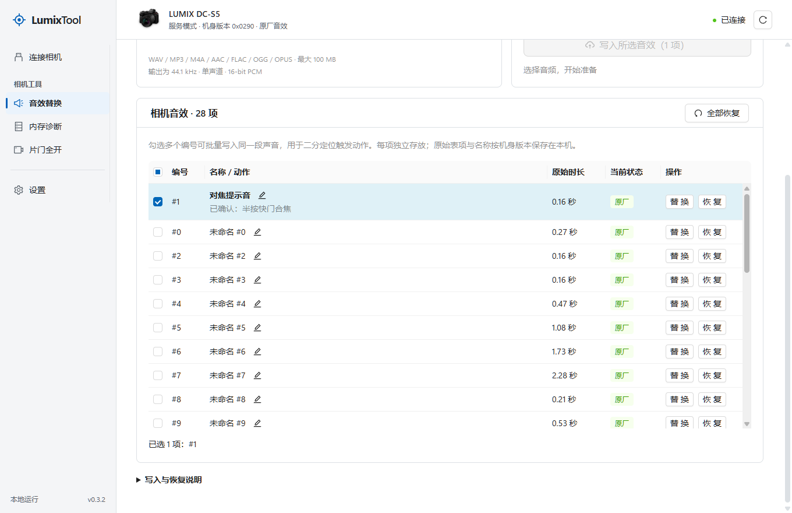
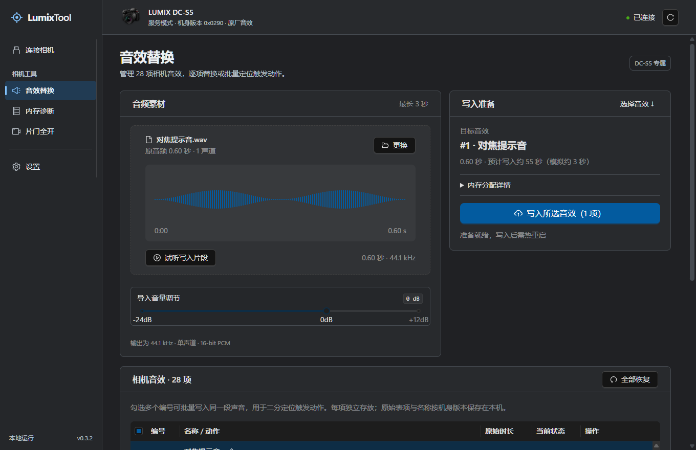

# LumixTool

**简体中文** | [English](README.en.md) | [日本語](README.ja.md)

给 Panasonic LUMIX 相机用的本地工具箱：通过服务模式的 USB 接口，零刷机解锁 6K 片门全开 / 不限时录制，并自定义相机的对焦音、电子快门音、自拍倒计时等全部 28 项提示音。

> ⚠️ **验证范围**：目前只在 **松下 DC-S5（一代）+ v2.9 固件** 上进行过实机验证。片门全开会强制校验固件特征；音效写入只改易失性 RAM，请先用短音频、单个音效试用。

- 只改相机 **RAM**，不写 Flash：电源键关机再开机（热重启）后仍然有效，**拔电池或恢复出厂就会还原**。
- 音效写在相机 RAM 的暂存区（`0x8F000000` 起）里，写入前会检查，不会覆盖其它已写入的音效。
- 支持 **简体中文 / English / 日本語**，首次进入可选择语言，也可在「设置」中随时切换。
- 完全本地离线运行，不联网。



## 功能

| 工具 | 说明 |
|---|---|
| **音效替换** | 完整映射并列出全部 28 项机身音效（含对焦提示音 `#1–3`、电子快门单张 `#20–22`、电子连拍 `#11–13`、自拍倒计时 `#0` 等），提供常用预设一键选择、单项或批量写入及恢复原厂。支持 wav / mp3 / m4a / flac / ogg / opus，自动转成 44.1 kHz 单声道，最长 3 秒。 |
| **片门全开** | 一键解锁 6K 3:2、5.9K 16:9 与所有限时模式的不限时录制，也可以恢复原厂默认。写入前校验 13 处固件特征锚点，只改写 19 个易失性 RAM 半字。 |
| **内存诊断** | 只读扫描相机 RAM 暂存区，用分布图显示哪里空闲、哪里有数据、每个音效存在哪里，可导出 JSON。 |
| **连接相机** | 一键安装 WinUSB 驱动、检测驱动状态、引导进入服务模式。 |
| **多语言与设置** | 支持中文 / 英文 / 日文三语切换（首次启动引导 + 设置页随时切换），查看版本号与项目支持入口。 |

全部 28 项音效的反汇编核验记录见 [docs/S5_V29_FINDINGS_2026-11-25.md](docs/S5_V29_FINDINGS_2026-11-25.md) 与 [docs/SOUND_TABLE.md](docs/SOUND_TABLE.md)。

## Android 版（APK）

安卓版可以用手机通过 USB OTG 离线连接松下 LUMIX DC-S5 一代。需要 Android 8.0 或更高版本、支持 USB Host（OTG）的手机，以及能传输数据的 USB 线。片门全开与音效替换适用于相机官方固件 2.9。

| 页面 | 可以做什么 |
|---|---|
| 连接相机 | 动画标出机背的回放键和 AF-ON 键，演示按住双键时拨动电源开关的时机。连接后可查看机身固件和当前状态。 |
| 片门全开解锁 | 可开启或还原 6K 3:2、5.9K 16:9 录制规格，以及原有限时模式的不限时录制。两种高分辨率格式均为 23.98p、10 位 HEVC。 |
| 相机音效替换 | 提供「常用音效」（对焦音、电子快门单张/全3档、电子连拍、自拍倒计时）一键选择，也可切至「全部 28 项」自定义替换或恢复。写入可能较久，期间请保持 USB 连接，偶尔轻点相机触摸屏以防休眠。 |
| 设置 | 位于顶栏连接状态右侧：支持切换中/英/日语言、查看版本号、前往 GitHub 点 Star（OTA 更新暂未开发）。 |

<p>
  
  
</p>

**安装与首次连接**　从 [Releases](https://github.com/USER-HFC/Lumix_Tool/releases) 下载最新的 `LumixTool-*.apk`（调试签名，系统可能提示来源未知，允许安装即可）。启动后选择语言，点「连接相机」，跟随动画开机，通过 OTG 接好相机，并在 Android 弹窗中允许 USB 访问。

## Windows v0.3.2 截图

| | |
|---|---|
|  |  |
| **准备写入**　试听音频、调整音量，再确认目标音效和预计耗时。 | **写入中**　查看当前音效和整个批次的写入进度。 |
|  |  |
| **内存诊断**　扫描后查看可写入容量和空间分布。 | **音效列表**　快速选择常用音效或从 28 项中选择替换与恢复。 |

界面跟随系统切换浅色 / 深色：



> 截图来自 Windows v0.3.2 本地打包版。音效与进度数据来自模拟相机，已隐藏模拟调试工具栏。

## Windows 版系统要求与使用步骤

- Windows 10 / 11（64 位）；macOS / Linux 只能用模拟模式开发界面。
- Panasonic LUMIX DC-S5（v2.9 固件），以及一根能传数据的 USB 线。
- 不需要单独安装 Python，安装包里已经自带。

1. 到 [Releases](https://github.com/USER-HFC/Lumix_Tool/releases) 下载 `LumixTool-<版本>-win-x64.zip`，**全部解压到桌面或「文档」**后双击 `LumixTool.exe`（首次运行 SmartScreen 拦截时点「更多信息 → 仍要运行」）。
2. **进入服务模式**：相机关机，同时按住机背的回放键（▶）和 `AF-ON` 键不放，再开机，用 USB 连接电脑（设备管理器出现 `04DA:2370` 即成功）。
3. **安装驱动**（只需一次）：在「连接相机」中点「一键安装驱动」，失败时可参考 [docs/DRIVER_SETUP.md](docs/DRIVER_SETUP.md) 用 Zadig 安装。
4. **解锁片门全开 / 替换音效**：按界面指引操作；写入完成后用**电源键**关机再开机（**不要拔电池**）即可生效。

## 注意事项

- **写入很慢**：每个采样点约 2 ms，1 秒音频大约要 1.5 分钟。服务模式空闲 4–7 分钟会自动关机，写长音频时请关闭机身「自动休眠」或隔一会儿轻点触摸屏保持唤醒。
- **电子快门音提示**：`#20–22`（单张）与 `#11–13`（连拍）需在相机菜单切至**电子快门**并开启电子快门音量才能听到。
- **原厂备份**：首次连接会自动按机身版本备份原厂音效表项，恢复原厂或直接拔电池均可还原。

## 仓库结构

| 目录 | 内容 |
|---|---|
| [`app/`](app/) | LumixTool 桌面应用（Electron + React + Ant Design + Python 后端）与安卓前端。 |
| [`android/`](android/) | Android OTG 原生壳工程（WebView + USB Host 协议实现）。 |
| [`docs/`](docs/) | 固件分析与发现（[S5_V29_FINDINGS_2026-11-25.md](docs/S5_V29_FINDINGS_2026-11-25.md)）、音效表（[SOUND_TABLE.md](docs/SOUND_TABLE.md)）、驱动指南（[DRIVER_SETUP.md](docs/DRIVER_SETUP.md)）。 |
| `tools/`、`js/` | 实验性固件研究脚本（容器解析、OSD、反汇编等），**不是 LumixTool 应用的一部分**。 |

## 开发

```sh
cd app
npm ci
npm start            # 构建桌面界面并启动
npm run dev          # 开发模式（热更新）
npm test             # JS 单元测试（Python 测试：python3 -m unittest discover -s python/tests）
npm run build:android # 构建安卓前端资源
npm run dist:win     # 打包 Windows 免安装 zip
```

模拟模式（无需连相机）：

```sh
LUMIXTOOL_MOCK=1 npm start
```

## 致谢（Acknowledgements）

本项目在研究与开发过程中参考和借鉴了以下优秀开源项目，特此致谢：

- **[rileydeacon/s5-unlocker](https://github.com/rileydeacon/s5-unlocker)** — 提供了初代 DC-S5（MC801 v2.9）6K Open Gate / 5.9K / 不限时录制的 19 半字 RAM 补丁与 13 处固件特征锚点。
- **[yis2014/Lumix_S5](https://github.com/yis2014/Lumix_S5)** — 提供了 DC-S5 V2.9 固件深度逆向、5 轮 AES 全分区解密研究、内存地址表及扩展路线参考。

## 免责声明

本项目与 Panasonic 无关。服务模式和直接改写相机内存都不在官方支持范围内，使用风险自负。
